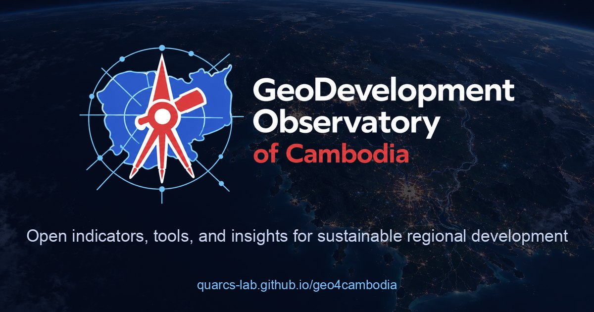

# GeoDevelopment Observatory of Cambodia (GDO-Cambodia)

[](https://quarcs-lab.github.io/geo4cambodia/)
[](https://pypi.org/project/geo4cambodia/)
[](https://pypi.org/project/geo4cambodia/)
[](https://github.com/quarcs-lab/geo4cambodia/actions/workflows/release.yml)
[](LICENSE)
[](https://colab.research.google.com/github/quarcs-lab/geo4cambodia/blob/main/notebooks/geo4cambodia_quickstart.ipynb)

**[Website](https://quarcs-lab.github.io/geo4cambodia/)** · **[Python package](https://pypi.org/project/geo4cambodia/)** · **[How the database works](docs/data-infrastructure.md)** · **[Quickstart notebook](https://colab.research.google.com/github/quarcs-lab/geo4cambodia/blob/main/notebooks/geo4cambodia_quickstart.ipynb)** · **[Cite](#-citation)**

The GeoDevelopment Observatory of Cambodia is a public-access platform for analyzing, monitoring and evaluating **sustainable regional development** in Cambodia. It has three parts:

- **GeoDevelopment Indicators:** environmental, social and economic indicators from satellite imagery, household surveys and administrative records, at every spatial scale.
- **GeoDevelopment Tools:** Python packages, notebooks and web apps to load, build and analyze them.
- **GeoDevelopment Insights:** accessible research summaries.

It serves:

- **Researchers**, who need ready-made subnational panels with reproducible code
- **Decision-makers**, who design, target and evaluate regional policies
- **Citizens**, who want to understand development in their own province or district

## 🚀 Quickstart

```python
!pip install -q geo4cambodia mapclassify             # every snippet runs in Google Colab
import geo4cambodia as geo

geo.datasets()                                       # what is available, at which scale and years
gdf = geo.load("gdppc", years=2022, geometry=True)   # 202 districts with boundaries
gdf.plot(column="y", cmap="magma", scheme="quantiles", k=5, legend=True)
```

[](https://colab.research.google.com/notebooks/empty.ipynb) [Open Google Colab.](https://colab.research.google.com/notebooks/empty.ipynb)

---

## 📊 GeoDevelopment Indicators

All data share one spatial backbone. Every unit at every scale has a **geo ID** that nests by prefix (GADM 4.1 hierarchy): district `KH-16-01` lies in province `KH-16`, which lies in Cambodia `KH`. Global Data Lab regions (`KH-GDL-08`) are unions of whole provinces. Each dataset is a panel with one row per unit (`geo_id`) and year, published as CSV and Parquet.

| Dataset | Title | Scale | Period | Files |
| --- | --- | --- | --- | --- |
| [`gdppc`](docs/datasets/gdppc.md) | Estimated GDP per capita | 202 districts | 1990–2022 | [`data/district/`](data/district/) |
| [`env`](docs/datasets/env.md) | Population, VIIRS-like lights, electricity-based GDP, NPP, PM2.5 | 25 provinces | 1990–2023 | [`data/province/`](data/province/) |
| [`hdi`](docs/datasets/hdi.md) | Human development, income, DMSP-like lights, population | 17 GDL regions | 2013–2019 | [`data/gdl/`](data/gdl/) |
| [`geo`](geo/) | Units, names, boundaries and crosswalks for every scale | 245 units | — | [`geo/`](geo/) |

Each dataset has three descriptions:
- a [Frictionless datapackage](metadata/)
- a generated page in [`docs/datasets/`](docs/datasets/), with its variable dictionary, coverage, sources and citation
- its rows in [`definitions_gdo-cambodia.csv`](definitions_gdo-cambodia.csv), which lists every variable of every dataset

### Load the data: two ways

**1. With the package.** One line gives a panel with names and boundaries, filtered by years and variables:

```python
!pip install -q geo4cambodia
import geo4cambodia as geo

geo.dictionary("gdppc")                                    # variables, units, aggregation rules
df = geo.load("env", years=(2000, 2020), variables=["total_VNL"])
wide = geo.load("gdppc", wide="y")                         # one column per year
geo.units("district")                                      # names, parents, source codes

geo.aggregate(geo.load("env"), to="gdl", dataset="env")    # provinces -> GDL regions (metadata rules)
geo.combine(["env", "hdi"], scale="gdl")                   # two datasets, one scale
geo.load("gdppc", ref="v0.3.0")                            # a frozen release of the data
```

[](https://colab.research.google.com/notebooks/empty.ipynb) [Open Google Colab.](https://colab.research.google.com/notebooks/empty.ipynb)

**2. Without the package.** Every file is a plain URL that pandas and geopandas (both preinstalled in Colab) read directly:

```python
import pandas as pd
import geopandas as gpd

BASE = "https://raw.githubusercontent.com/quarcs-lab/geo4cambodia/main/"
df = pd.read_csv(BASE + "data/district/gdppc.csv")             # geo_id, year, variables
units = pd.read_csv(BASE + "geo/units.csv")                     # names, parents, source codes
gdf = gpd.read_file(BASE + "geo/boundaries/district.geojson")   # polygons keyed by geo_id
```

[](https://colab.research.google.com/notebooks/empty.ipynb) [Open Google Colab.](https://colab.research.google.com/notebooks/empty.ipynb)

### Build your own indicators

The package can also:
- link your own tables to the same units, by names in any spelling or by codes
- extract indicators from rasters
- move data onto grids or other zones
- save the results in the same documented format

```python
!pip install -q "geo4cambodia[raster]"                              # [raster] adds rasterio for geo.zonal()
import geo4cambodia as geo

mine = geo.link(my_table, scale="province", on="Province")         # "BântéayMéanchey" -> KH-01
ntl = geo.zonal("viirs_2020.tif", scale="district", name="ntl", year=2020)
panel = geo.combine(["env"], scale="province", extra=[mine])
geo.save(panel, "my_indicator", scale="province", directory="my_data")
df, df_def = geo.for_expdpy(panel)                                  # inputs for expdpy (panel econometrics)
gdf, df, df_dict = geo.for_geometrics("gdppc")                      # inputs for geometrics (spatial analysis)
```

[](https://colab.research.google.com/notebooks/empty.ipynb) [Open Google Colab.](https://colab.research.google.com/notebooks/empty.ipynb)

The full guide is [`docs/data-infrastructure.md`](docs/data-infrastructure.md). It covers the scales and IDs, the metadata and aggregation rules, and recipes for building indicators. To add a dataset to the observatory, see [`CONTRIBUTING_DATA.md`](CONTRIBUTING_DATA.md).

---

## 🐍 GeoDevelopment Tools

### Python packages

| Package | What it does | Install (Google Colab) |
| --- | --- | --- |
| **[geo4cambodia](docs/python-package.md)** | Load every indicator as a panel with boundaries, link your own data, extract indicators from rasters, move data across scales | `!pip install -q geo4cambodia` |
| **[expdpy](https://cmg777.github.io/expdpy/)** | Panel exploration and econometrics: within/between variation, trajectories, fixed and random effects, Hausman tests, clustered SEs; `geo.for_expdpy()` prepares the observatory's data for it in one line | `!pip install -q geo4cambodia expdpy` |
| **[geometrics](https://quarcs-lab.github.io/geometrics/)** | Regional growth, convergence and inequality with spatial methods; `geo.for_geometrics()` prepares the observatory's data for it in one line | `!pip install -q geo4cambodia geometrics` |

### Cloud-based notebooks

| Notebook | Description |
| --- | --- |
| [Load, link and build indicators with geo4cambodia](https://colab.research.google.com/github/quarcs-lab/geo4cambodia/blob/main/notebooks/geo4cambodia_quickstart.ipynb) | Load data with and without the package, move it across scales, link your own table, and build an indicator from a raster |
| [Exploring Cambodia's subnational panels with expdpy](https://colab.research.google.com/github/quarcs-lab/geo4cambodia/blob/main/notebooks/expdpy_explore.ipynb) | geo4cambodia + expdpy: panel structure, within/between variation, trajectories, transitions, missing values and correlations at three scales |
| [Panel econometrics for Cambodia with expdpy](https://colab.research.google.com/github/quarcs-lab/geo4cambodia/blob/main/notebooks/expdpy_analyze.ipynb) | geo4cambodia + expdpy: lights and income, human development, convergence with and without space, pollution and development (FE, RE, Hausman) |
| [Are Cambodia's districts converging?](https://colab.research.google.com/github/quarcs-lab/geo4cambodia/blob/main/notebooks/geometrics_convergence.ipynb) | geo4cambodia + geometrics: LISA clusters, β-, σ- and club convergence, and inequality between and within provinces |
| [Monitoring subnational human development](https://colab.research.google.com/github/quarcs-lab/geo4cambodia/blob/main/notebooks/hdi_ntl_esda.ipynb) | Maps, trajectories and spatial clusters of the Human Development Index and night-time lights |
| [District GDP per capita: EDA](https://colab.research.google.com/github/quarcs-lab/geo4cambodia/blob/main/notebooks/districts202_gdppc_eda.ipynb) | Descriptive statistics and growth paths for 202 districts |
| [District GDP per capita: ESDA](https://colab.research.google.com/github/quarcs-lab/geo4cambodia/blob/main/notebooks/districts202_gdppc_esda.ipynb) | Spatial weights, Moran's I and LISA clusters |

### Web apps

- [Localized dynamics of luminosity-based GDP](https://carlos-mendez.projects.earthengine.app/view/egdp-dynamics-cambodia) (source in [`apps/`](apps/))
- [Comparative regional dynamics of luminosity-based GDP](https://carlos-mendez.projects.earthengine.app/view/space-time-dynamics-egdp-cambodia)
- [Land surface temperature, soil moisture and land cover](https://ee-yukietohjaxa.projects.earthengine.app/view/lst-smc-byregion)
- [Poverty mapping dashboard](https://cambodiapovertymapping.sig-gis.com/en/map/) (Spatial Informatics Group)

---

## 💡 GeoDevelopment Insights

- **[Mapping Cambodian poverty with big data and AI](https://quarcs-lab.github.io/geo4cambodia/#/insights/poverty-paper)**: Khoun, T., Poortinga, A., Thwal, N. S., González de Alba, I., McMahon, A., & Mendez, C. (2025). *Social Indicators Research*, 180(3), 1593–1618. [doi:10.1007/s11205-025-03718-3](https://doi.org/10.1007/s11205-025-03718-3)
- **[Development studies in the age of AI](https://quarcs-lab.github.io/geo4cambodia/#/insights/development-age-of-ai)**: video, podcast and slides
- **[The view from above](https://quarcs-lab.github.io/geo4cambodia/#/insights/view-from-above)**: an introductory video

On the [website](https://quarcs-lab.github.io/geo4cambodia/#insights) they come with embedded videos, audio, story books and an AI chatbot.

---

## 🛠️ For developers

### Repository structure

```text
geo4cambodia/
├── index.html                    # The website (React 18 + Tailwind, no build step)
├── 404.html, robots.txt, sitemap.xml, site.webmanifest, .nojekyll
├── project.yaml                  # Project identity: name, package, repository, country codes
├── raw/                          # Original inputs, never edited
├── geo/                          # Spatial backbone: scales.yaml, units, boundaries/, crosswalks/
├── data/<scale>/                 # Published panels: <dataset>.csv + .parquet (generated)
├── metadata/                     # One Frictionless datapackage per dataset (source of truth)
├── docs/                         # Guides (data-infrastructure, python-package, publishing) + datasets/ (generated)
├── definitions_gdo-cambodia.csv  # All variables of all datasets (generated)
├── src/geo4cambodia/             # Python package: load, link, zonal, aggregate, overlay, combine, save, build, validate
├── tests/                        # test_core.py (generic) + test_project.py (Cambodia facts)
├── notebooks/                    # Colab notebooks (.ipynb) paired with MyST markdown (.md)
├── apps/                         # Earth Engine app source code
├── code/                         # Pointers to data-preparation code
├── scripts/                      # new_project.py: start a geo4<country> project from this template
├── media/, images/               # Site assets
├── .github/workflows/release.yml # Publishes the package to PyPI on version tags
├── CONTRIBUTING_DATA.md          # How to add a dataset or a scale
├── TEMPLATE.md                   # How to reuse this repository for another country
├── pyproject.toml, uv.lock       # Python package and environment (uv)
└── CITATION.cff, LICENSE, CLAUDE.md
```

### Run locally

```bash
uv sync                          # environment + the geo4cambodia package (editable)
uv run geo4cambodia build        # regenerate geo/, data/, docs/ from raw/
uv run geo4cambodia validate     # check IDs, schemas, nesting and file consistency
uv run pytest                    # run the test suite
uv run jupyter lab notebooks/    # open the notebooks
python3 -m http.server 8000      # preview the website at http://localhost:8000
```

### Releasing the package

Bump the version in `pyproject.toml` and `src/geo4cambodia/__init__.py`, commit, and push a matching tag (`git tag vX.Y.Z && git push origin vX.Y.Z`). The [release workflow](.github/workflows/release.yml) publishes it to PyPI. Details are in [`docs/publishing.md`](docs/publishing.md).

### A template for other countries

This repository is also the template of a family of `geo4<country>` projects. They share one design: geo IDs, long panels, Frictionless metadata and the same package API. Every project-specific setting lives in `project.yaml`. This command creates a new project:

```bash
python scripts/new_project.py ../geo4laos --package geo4laos --country Laos \
    --iso2 LA --iso3 LAO --repo my-org/geo4laos
```

See [`TEMPLATE.md`](TEMPLATE.md).

### The website

The site is a single `index.html` with no build step. Every item (indicator, package, notebook, app, insight, event) is an entry in the `CONTENT_REGISTRY` array, and each entry gets a shareable detail page at `#/<section>/<id>`. GitHub Pages publishes the `main` branch directly.

---

## 👥 Team

**Core team**

- [Carlos Mendez](https://carlos-mendez.org) (Nagoya University, Japan)
- Theara Khoun (UNDP Cambodia)
- Ate Poortinga (Spatial Informatics Group, USA)

**Research assistants**

- [Li Xiaomeng](https://carlos-mendez.org/authors/lixiaomeng/) (Nagoya University, Japan)
- [He Du](https://carlos-mendez.org/authors/hedu/) (Nagoya University, Japan)

**Contact**

- Carlos Mendez: carlos.mendez.n9 [at] f.mail.nagoya-u.ac.jp
- Theara Khoun: theara.khoun [at] undp.org
- Ate Poortinga: apoortinga [at] sig-gis.com

**Community:** questions and ideas are welcome in [GitHub Discussions](https://github.com/quarcs-lab/geo4cambodia/discussions).

---

## 📝 Citation

> Mendez, C., Khoun, T., & Poortinga, A. (2026). *GeoDevelopment Observatory of Cambodia*. <https://quarcs-lab.github.io/geo4cambodia/>

```bibtex
@misc{gdocambodia2026,
  author       = {Mendez, Carlos and Khoun, Theara and Poortinga, Ate},
  title        = {{GeoDevelopment Observatory of Cambodia}},
  year         = {2026},
  howpublished = {\url{https://quarcs-lab.github.io/geo4cambodia/}},
  note         = {Data and code: https://github.com/quarcs-lab/geo4cambodia}
}
```

Please also cite the original source of each dataset you use. The citations are listed on each dataset's page in [`docs/datasets/`](docs/datasets/).

---

**Disclaimer.** The indicators, tools and insights are the responsibility of the individual researchers and do not necessarily represent the views of their affiliated institutions or related organizations. Maps are for geo-statistical use only. They have a referential, informational character and do not represent an official definition of Cambodia's territorial boundaries.

**License.** Code and data in this repository: [MIT](LICENSE). Original data sources are credited on each dataset's page in `docs/datasets/`. Hero and section illustrations were generated with OpenAI image generation (via Codex).
