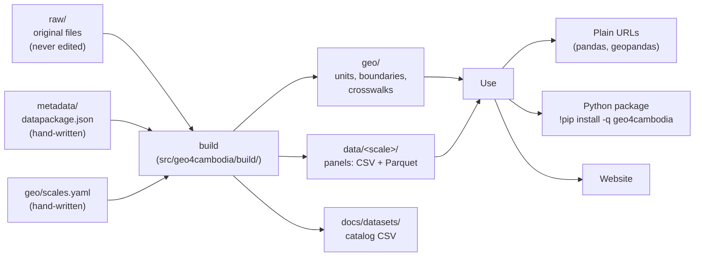

# How the data infrastructure works

This guide explains the **indicators database** behind the observatory: how spatial units, datasets and metadata fit together, how to load data (with or without the Python package), and how to build your own indicators with the package, for example in Google Colab.

> The examples use **geo4cambodia**, the reference implementation of this template. A project created from it (e.g. `geo4laos`) works the same way with its own package name, country code and datasets. See [`TEMPLATE.md`](../TEMPLATE.md).

**Contents**

1. [The big picture](#1-the-big-picture)
2. [Spatial scales and geo IDs](#2-spatial-scales-and-geo-ids)
3. [The geography layer](#3-the-geography-layer-geo)
4. [The indicators database](#4-the-indicators-database)
5. [Loading data: two ways](#5-loading-data-two-ways)
6. [Building your own indicators](#6-building-your-own-indicators-with-the-package)
7. [Package reference](#7-package-reference)
8. [Maintaining the database](#8-maintaining-the-database)
9. [Design decisions](#9-design-decisions)

---

## 1. The big picture



Four rules hold everything together:

1. **Every spatial unit has one geo ID** (`geo_id`), at every scale. IDs nest by prefix: `KH-16-01` lies in `KH-16`, which lies in `KH`.
2. **Every dataset is a long panel**: one row per unit (`geo_id`) and `year`, one column per variable, stored in `data/<scale>/<dataset>.csv` and `.parquet`.
3. **Metadata is the source of truth.** A Frictionless datapackage per dataset describes every variable (description, unit, source, aggregation rule). Documentation is generated from it.
4. **Nothing published is edited by hand.** Original inputs stay untouched in `raw/`; `geo4cambodia build` regenerates `geo/`, `data/` and `docs/datasets/`, and `geo4cambodia validate` checks them.

| Folder or file | What it holds | Edited by hand? |
| --- | --- | --- |
| `project.yaml` | Project identity: name, package, GitHub repository, country code, equal-area projection | yes |
| `geo/scales.yaml` | The registry of spatial scales and their ID patterns | yes |
| `raw/` | Original inputs (data, boundaries, lookup tables) | added, never edited |
| `metadata/<dataset>.datapackage.json`, `metadata/index.json` | Dataset descriptions and the list of datasets | yes |
| `src/geo4cambodia/build/` | One builder per dataset, plus the geography builder | yes |
| `geo/units.*`, `geo/boundaries/`, `geo/crosswalks/` | The geography layer | generated |
| `data/<scale>/<dataset>.*` | Published panels | generated |
| `docs/datasets/*.md`, `data/README.md`, the catalog CSV | Documentation | generated |

---

## 2. Spatial scales and geo IDs

A **scale** is a set of units that tile the country: provinces, districts, Global Data Lab regions, grid cells... Scales are registered in [`geo/scales.yaml`](../geo/scales.yaml):

```yaml
district:
  label: District
  kind: admin            # admin | grouping | grid | custom
  level: 2               # administrative level (GADM)
  parent: province       # the next coarser scale it nests in exactly
  id_pattern: '^KH-\d{2}-\d{2}$'
  example: KH-16-01
  source: GADM 4.1 level 2
  status: active         # active: published in geo/ | planned: reserved
```

| Field | Meaning |
| --- | --- |
| `kind` | `admin`: administrative units that nest by ID prefix. `grouping`: unions of whole units of another scale (set `children:`). `grid`: regular cells. `custom`: any other zones (watersheds, historical boundaries) |
| `parent` | Coarser scale every unit lies in exactly. Defines the hierarchy used by `aggregate()` |
| `children` | For a grouping: the scale whose whole units it unites (e.g. GDL regions unite provinces) |
| `id_pattern` | Regular expression every ID of the scale must match. Patterns must not overlap, so an ID tells its scale |
| `digits` | Zero-padding of this level's part of the ID (default 2) |
| `status` | `planned` reserves the scale and its ID scheme before data exist |

**Geo IDs in geo4cambodia**

| Scale | Units | Pattern | Example | Nests in |
| --- | --- | --- | --- | --- |
| `country` | 1 | `KH` | `KH` | — |
| `province` | 25 | `KH-NN` | `KH-16` (Phnom Penh) | country, gdl |
| `district` | 202 | `KH-NN-NN` | `KH-16-01` | province → country, gdl |
| `gdl` | 17 | `KH-GDL-NN` | `KH-GDL-02` | country |
| `commune` | planned | `KH-NN-NN-NN` | `KH-16-01-01` | district |
| `grid10k` | planned | `KH-G10K-rNNNcNNN` | `KH-G10K-r012c034` | (overlay) |

Administrative numbers follow the GADM order. Codes from other sources are **kept as columns**, never used as keys: in Cambodia, ISO 3166-2 numbers differ from GADM order (Phnom Penh is `KH-16` here and `KH-12` in ISO), so `shapeISO` is a column of `geo/units.csv`.

---

## 3. The geography layer (`geo/`)

| File | Contents |
| --- | --- |
| `units.csv` / `.parquet` | One row per unit of every scale: `geo_id`, `scale`, `name`, `parent_id`; one `<scale>_id` column per scale it lies in (`country_id`, `province_id`, `district_id`, `gdl_id`); source keys (`gid` = GADM, `shapeISO` and `shapeID` = geoBoundaries, `GDLcode` = Global Data Lab); source spellings (`name_gadm`, ...); `area_km2` |
| `boundaries/<scale>.geojson` / `.parquet` | Polygons in WGS 84 with `geo_id` and `name`. Coarser scales are dissolved from the finest one, so they nest exactly |
| `crosswalks/<from>__<to>.csv` | `geo_id_from`, `geo_id_to`, `weight_area` for every nested pair, finer to coarser (`district__province.csv`) |

The `<scale>_id` columns make any join across scales a one-liner: every district row already says its province, GDL region and country.

---

## 4. The indicators database

### Datasets

A **dataset** is a set of variables from one source, published at one or more scales:

```
data/district/gdppc.csv        geo_id, year, GID_2, y, ln_y, trend6_ln_y, ...
data/district/gdppc.parquet    the same table, typed and compressed
metadata/gdppc.datapackage.json
docs/datasets/gdppc.md         generated: dictionary, coverage, sources, citation
```

Each table is a **long panel**: one row per unit and year, sorted by `geo_id` and `year`. Optional `source_key` columns (here `GID_2`) keep the original identifier next to `geo_id` for traceability. Wide tables (one column per year) are produced on demand, never stored.

| Dataset | Scale | Years | Variables |
| --- | --- | --- | --- |
| `gdppc` | district (202) | 1990–2022 | GDP per capita, its log and HP trends |
| `env` | province (25) | 1990–2023 | population, VIIRS-like lights, electricity-based GDP, NPP, PM2.5 |
| `hdi` | gdl (17) | 2013–2019 | HDI, GNI, population, DMSP-like lights |

### Metadata

`metadata/<dataset>.datapackage.json` is a [Frictionless Data Package](https://datapackage.org/) with one resource per scale. Project-specific information lives in `geo:` properties:

| Level | Property | Meaning |
| --- | --- | --- |
| package | `name`, `title`, `description`, `licenses`, `sources` | standard Frictionless fields |
| package | `geo:categories`, `geo:citation`, `geo:notes`, `geo:notebooks` | shown on the dataset page |
| resource | `path` | public URL of the CSV (checked by `validate`) |
| resource | `geo:scale`, `geo:period` | the scale and `[first, last]` year |
| resource | `geo:path`, `geo:parquet` | file paths inside the repository |
| resource | `geo:source_geometry` | polygons the values were computed on, if different from `geo/boundaries` |
| field | `type`, `description`, `constraints` | standard Table Schema (`pattern`, `minimum`, `maximum`, `required`) |
| field | `geo:role` | `id`, `time`, `source_key` (with `geo:units_column`) or `variable` (default) |
| field | `geo:unit`, `geo:source` | unit of measure and source of the variable |
| field | `geo:aggregation` | how the variable moves to coarser scales (below) |

`metadata/index.json` lists the dataset ids, so remote users can discover them.

### Aggregation rules

| Rule | Use for | Example |
| --- | --- | --- |
| `sum` | counts and totals | population, GDP, zonal sums of lights |
| `weighted_mean:<field>` | rates and averages, weighted by another field | HDI weighted by `POP` |
| `mean`, `min`, `max` | unweighted summaries (use with care) | — |
| `none` | values that cannot be aggregated without more data | logs, HP trends, per-capita values without population |

`aggregate()` raises an error for `none` variables you ask for explicitly and otherwise leaves them out with a warning; `combine()` drops them with a warning. Pass `rules=` to keep them. `overlay()` needs you to say which variables are *extensive* (totals, split by area) and which are *intensive* (rates, area-weighted means).

---

## 5. Loading data: two ways

All code below assumes **Google Colab**: each block starts with the line that installs what Colab lacks, so it runs in a new notebook once you replace placeholder inputs (your own tables, rasters or zones).

### A. Without the package

Every file is a plain URL: `https://raw.githubusercontent.com/quarcs-lab/geo4cambodia/main/<path>`. Use `main` for the latest data, or a release tag (e.g. `v0.3.0`) for a frozen version. pandas and geopandas are preinstalled in Colab, so nothing needs installing:

```python
import pandas as pd
import geopandas as gpd

BASE = "https://raw.githubusercontent.com/quarcs-lab/geo4cambodia/main/"

df = pd.read_csv(BASE + "data/district/gdppc.csv")                 # panel: geo_id, year, variables
units = pd.read_csv(BASE + "geo/units.csv")                         # names, parents, source keys
df = df.merge(units[["geo_id", "name", "province_id"]], on="geo_id")

gdf = gpd.read_file(BASE + "geo/boundaries/district.geojson")       # polygons with geo_id
gdf.merge(df[df.year == 2022], on="geo_id").plot(column="y", legend=True)

xw = pd.read_csv(BASE + "geo/crosswalks/district__province.csv")    # district -> province
```

[](https://colab.research.google.com/notebooks/empty.ipynb) [Open Google Colab.](https://colab.research.google.com/notebooks/empty.ipynb)

### B. With the package (Python)

```python
!pip install -q geo4cambodia
import geo4cambodia as geo

geo.datasets()                                     # datasets x scales x years
geo.dictionary("gdppc")                            # variables, units, aggregation rules
df  = geo.load("gdppc")                            # panel: geo_id, year, variables
gdf = geo.load("gdppc", years=2022, geometry=True) # GeoDataFrame, ready to map
w   = geo.load("gdppc", wide="y")                  # one row per district, y1990 ... y2022
sub = geo.load("env", years=(2000, 2020), variables=["total_VNL"])
names = geo.units("district")                      # names, parents, source keys
shapes = geo.boundaries("province")
xw = geo.crosswalk("district", "province")
geo.load("gdppc", ref="v0.3.0")                    # a frozen release of the data
```

[](https://colab.research.google.com/notebooks/empty.ipynb) [Open Google Colab.](https://colab.research.google.com/notebooks/empty.ipynb)

Inside a clone of the repository the package reads the local files. Anywhere else it downloads them from GitHub, caching each file for the session.

| | Without the package | With the package |
| --- | --- | --- |
| Install (Colab) | nothing | `!pip install -q geo4cambodia` |
| Names, boundaries | merge `geo/units.csv`, `geo/boundaries/*.geojson` yourself | `geometry=True`, `geo.units()` |
| Filters, wide format | by hand | `years=`, `variables=`, `wide=` |
| Across scales | join a crosswalk and aggregate by hand | `geo.aggregate()`, `geo.overlay()`, `geo.combine()` |
| Your own data | — | `geo.link()`, `geo.zonal()`, `geo.check()`, `geo.save()` |
| Panel econometrics | prepare inputs yourself | `geo.for_expdpy()` → [expdpy](https://cmg777.github.io/expdpy/) |
| Spatial analysis | prepare inputs yourself | `geo.for_geometrics()` → [geometrics](https://quarcs-lab.github.io/geometrics/) |

---

## 6. Building your own indicators with the package

Everything below runs in Google Colab. Each block starts with its install line: `!pip install -q geo4cambodia`, or `!pip install -q "geo4cambodia[raster]"` when it uses `zonal()` (the extra adds rasterio).

### Recipe 1: link your own table by unit names or codes

Data from a report, survey or ministry usually identifies units by name, often spelled differently. `geo.link()` attaches `geo_id`, ignoring accents, case, spaces and punctuation, and tries every name and code column of `geo.units()`:

```python
!pip install -q geo4cambodia
import pandas as pd
import geo4cambodia as geo

mine = pd.DataFrame({
    "Province": ["BântéayMéanchey", "Phnom Penh", "Siem Reap"],
    "year": [2020, 2020, 2020],
    "schools": [812, 640, 1033],
})
mine = geo.link(mine, scale="province", on="Province")   # adds geo_id: KH-01, KH-16, KH-21
geo.check(mine, scale="province")                         # [] means it is a valid panel
```

[](https://colab.research.google.com/notebooks/empty.ipynb) [Open Google Colab.](https://colab.research.google.com/notebooks/empty.ipynb)

Unmatched values raise an error that suggests the closest spelling (`errors="warn"` to continue). Pass `key="shapeISO"`, `key="gid"` or `key="GDLcode"` to match a specific code.

### Recipe 2: extract an indicator from a raster

Summarise any GeoTIFF (an Earth Engine export, WorldPop, a land-cover map) over the units of a scale:

```python
!pip install -q "geo4cambodia[raster]"
import geo4cambodia as geo

lights = geo.zonal("viirs_2020.tif", scale="district", stats=["sum", "mean"], name="ntl", year=2020)
# geo_id, year, ntl_sum, ntl_mean

series = geo.zonal({2019: "viirs_2019.tif", 2020: "viirs_2020.tif"}, scale="district", name="ntl")
```

[](https://colab.research.google.com/notebooks/empty.ipynb) [Open Google Colab.](https://colab.research.google.com/notebooks/empty.ipynb)

Pixels count when their centre falls inside a unit (`all_touched=True` for very small units); nodata is ignored. URLs work too.

### Recipe 3: combine datasets and derive a new indicator

`geo.combine()` loads several datasets at one scale, aggregating finer ones with their metadata rules:

```python
!pip install -q geo4cambodia
import geo4cambodia as geo

panel = geo.combine(["env", "hdi"], scale="gdl", years=(2013, 2019))
panel["lights_per_capita"] = panel["total_VNL"] / panel["total_GlobPOP_Count"]

# add your own data at the same scale
panel = geo.combine(["hdi"], scale="gdl", extra=[my_gdl_table])
```

[](https://colab.research.google.com/notebooks/empty.ipynb) [Open Google Colab.](https://colab.research.google.com/notebooks/empty.ipynb)

Variables without an aggregation rule are dropped with a warning when they would need aggregating; columns with the same name get the dataset id as prefix (`hdi_POP`).

### Recipe 4: move data across scales

```python
!pip install -q geo4cambodia
import geo4cambodia as geo

env = geo.load("env", years=2020)

# up a nested hierarchy, with the metadata rules
geo.aggregate(env, to="gdl", dataset="env")
geo.aggregate(env, to="country", dataset="env", variables=["total_GlobPOP_Count"])

# your own rules (e.g. a population-weighted mean)
geo.aggregate(df, to="province", rules={"y": "weighted_mean:pop"}, weights=pop)

# onto units that do not nest: a grid, watersheds, old boundaries
cells = geo.overlay(env, my_grid, extensive=["total_GlobPOP_Count"], id_col="cell")
weights = geo.overlay_weights("district", my_zones, id_col="zone")   # the area shares used
```

[](https://colab.research.google.com/notebooks/empty.ipynb) [Open Google Colab.](https://colab.research.google.com/notebooks/empty.ipynb)

`overlay()` assumes values are spread evenly within each source unit. Totals (`extensive`) are split by area and summed; rates (`intensive`) are area-weighted means.

### Recipe 5: save it like a published dataset

```python
!pip install -q geo4cambodia
import geo4cambodia as geo

panel = geo.combine(["env", "hdi"], scale="gdl", years=(2013, 2019))
panel["lights_per_capita"] = panel["total_VNL"] / panel["total_GlobPOP_Count"]
geo.save(panel, "lights_pc", scale="gdl", directory="my_data",
         title="Night-time lights per capita",
         description="VIIRS-like lights divided by population, 17 GDL regions.",
         variables={"lights_per_capita": {"description": "Lights per person", "unit": "nW/cm²/sr per person",
                                          "aggregation": "none", "source": "Derived from env"}},
         sources=["GeoDevelopment Observatory of Cambodia"])
# my_data/data/gdl/lights_pc.csv, .parquet and my_data/metadata/lights_pc.datapackage.json
```

[](https://colab.research.google.com/notebooks/empty.ipynb) [Open Google Colab.](https://colab.research.google.com/notebooks/empty.ipynb)

The output has the same layout and metadata as the published datasets, so it is easy to share or contribute.

### Recipe 6: analyse it with geometrics

[geometrics](https://quarcs-lab.github.io/geometrics/) is the companion package for the analysis: maps, spatial weights, Moran's I and LISA, β-, σ- and club convergence, spatial regressions, distribution dynamics and inequality decompositions. It takes three inputs, `gdf`, `df` and `df_dict`; `geo.for_geometrics()` returns them for any dataset, or for a panel you built:

```python
!pip install -q geo4cambodia geometrics
import geo4cambodia as geo
import geometrics as gm

gdf, df, df_dict = geo.for_geometrics("gdppc")                 # or geo.for_geometrics(my_panel)
df = gm.set_labels(df, df_dict, set_panel=True)
w = gm.make_weights(gdf, method="queen")
gm.explore_lisa_cluster_map(df, "ln_y", gdf=gdf, w=w, period=2022).fig
res = gm.analyze_beta_convergence(df, "y", gdf=gdf, w=w)          # levels: geometrics logs them
print(res.interpret())
```

[](https://colab.research.google.com/notebooks/empty.ipynb) [Open Google Colab.](https://colab.research.google.com/notebooks/empty.ipynb)

**geo4cambodia gets the data ready; geometrics analyses it.** Note the convention: geometrics' convergence functions take **levels** (`"y"`) and log them internally.

### Recipe 7: analyse panels with expdpy

[expdpy](https://cmg777.github.io/expdpy/) is the companion package for panel data:
- exploration: panel structure, within/between variation (`xtsum`), trajectories, transitions, missing values, correlations
- econometrics: pooled, between, fixed and random effects, Hausman tests, fixed-effects regressions with clustered standard errors, IV, event studies, non-spatial convergence

It takes a long panel and a data dictionary; `geo.for_expdpy()` returns both, labelled from the metadata. `groups=` adds the names of coarser units (e.g. the province of each district) for by-group views:

```python
!pip install -q geo4cambodia expdpy
import numpy as np
import geo4cambodia as geo
import expdpy as ex

df, df_def = geo.for_expdpy("gdppc", groups=["province"])      # or geo.for_expdpy(my_panel, labels={...})
df = ex.set_labels(df, df_def, set_panel=True)                  # geo_id x year
ex.explore_xtsum_table(df, var=["ln_y"]).gt                     # between vs within variation
ex.explore_trend_plot_by_group(df, group_var="province", var="ln_y").fig

hd = geo.combine({"hdi": None, "env": ["total_GlobPOP_Count"]}, scale="gdl")   # HDI + population
hd["ln_pop"] = np.log(hd["total_GlobPOP_Count"])
hd, hd_def = geo.for_expdpy(hd)                                  # your own panel: labels kept
hd = ex.set_labels(hd, hd_def, set_panel=True)
ex.analyze_panel_table(hd, "HDI", ["lnNTLpc", "ln_pop"]).etable  # pooled, between, FE, RE side by side
print(ex.analyze_hausman_test(hd, "HDI", ["lnNTLpc", "ln_pop"]).interpret())
```

[](https://colab.research.google.com/notebooks/empty.ipynb) [Open Google Colab.](https://colab.research.google.com/notebooks/empty.ipynb)

expdpy analyses the variable as given, so pass logs where you want logs (`"ln_y"`).

### Recipe 8: contribute it to the observatory

To publish a dataset in the repository, it must be reproducible from its originals: put them in `raw/<dataset>/`, write the metadata, add a small builder, then `build` and `validate`. Follow [`CONTRIBUTING_DATA.md`](../CONTRIBUTING_DATA.md); `geo.save()`'s datapackage is a good starting point for the metadata.

---

## 7. Package reference

| Function | Purpose |
| --- | --- |
| `datasets()` | Table of datasets, scales, years and file paths |
| `dictionary(dataset)` | Variable dictionary: description, unit, role, aggregation, source |
| `load(dataset, scale=None, years=None, variables=None, wide=None, geometry=False, ref=None)` | Load a panel |
| `units(scale=None)` | Units with names, parents, `<scale>_id` columns and source keys |
| `boundaries(scale)` | GeoDataFrame of a scale's polygons |
| `crosswalk(source, target)` | Links between two nested scales |
| `scales(active_only=False)`, `ancestors(scale)`, `scale_of(geo_id)` | The scale registry |
| `link(df, scale, on, key="auto", errors="raise")` | Attach `geo_id` to a table by names or codes |
| `check(df, scale=None)` | List the problems that keep a table from being a valid panel |
| `combine(datasets, scale, years=None, extra=(), rules=None)` | Several datasets (and your tables) as one panel at one scale |
| `zonal(raster, scale, stats=("sum", "mean"), name="value", year=None)` | Summarise a raster over units |
| `aggregate(df, to, dataset=None, rules=None, variables=None, weights=None)` | Move a panel up the hierarchy |
| `overlay(df, target, extensive=(), intensive=(), id_col="geo_id")`, `overlay_weights(...)` | Area-weighted interpolation to non-nested units |
| `save(df, name, scale, directory=".", ...)` | Write CSV, Parquet and a datapackage |
| `for_expdpy(data, scale=None, years=None, variables=None, labels=None, groups=None)` | `(df, df_def)` for the [expdpy](https://cmg777.github.io/expdpy/) package |
| `for_geometrics(data, scale=None, years=None, variables=None, labels=None, groups=None)` | `(gdf, df, df_dict)` for the [geometrics](https://quarcs-lab.github.io/geometrics/) package |
| `config()` | The project settings (project.yaml) |

Every function has a docstring: `help(geo.link)`.

**Environment variables** (prefix = package name in capitals):

| Variable | Effect |
| --- | --- |
| `GEO4CAMBODIA_REF` | Default git ref for remote reads (a branch or release tag) |
| `GEO4CAMBODIA_DATA_DIR` | Read from this local checkout |
| `GEO4CAMBODIA_BASE_URL` | Read from a mirror; `{ref}` is replaced by the ref |

---

## 8. Maintaining the database

```bash
uv sync                              # environment + the package (editable)
uv run geo4cambodia build            # everything: geo, every dataset, catalog
uv run geo4cambodia build geo        # only the geography layer
uv run geo4cambodia build env        # one dataset
uv run geo4cambodia validate         # all checks; non-zero exit on failure
uv run geo4cambodia list             # datasets x scales x years
uv run pytest                        # tests/test_core.py (generic) + tests/test_project.py
```

`validate` checks:
- **Geography:** unique IDs that match their scale's pattern, parents that exist, prefix nesting for admin scales, valid WGS 84 boundaries, complete crosswalks whose weights sum to 1, and every unit at least 99.5% inside its parent.
- **Datasets:** the datapackage fields, the public URL, columns in schema order, CSV identical to Parquet, types and constraints, source keys consistent with `geo/units`, unique `(geo_id, year)`, known IDs and years matching `geo:period`.

How-tos:
- Add a dataset or a scale: [`CONTRIBUTING_DATA.md`](../CONTRIBUTING_DATA.md).
- Start a project for another country: [`TEMPLATE.md`](../TEMPLATE.md).
- Release the package on PyPI: [`publishing.md`](publishing.md).

---

## 9. Design decisions

- **GADM as the administrative backbone.** It covers every country in one consistent format, and its codes give stable nested IDs. Other sources (geoBoundaries, ISO, Global Data Lab) are linked through columns of `geo/units`.
- **Long panels, not wide files.** One shape for every dataset makes loading, combining, validating and aggregating generic. Wide tables are one `pivot` (or `wide=`) away.
- **CSV and Parquet.** CSV for universal access (Excel, any tool); Parquet for exact types and speed. The validator keeps them identical.
- **Aggregation rules in the metadata.** Whether a variable can be summed or must be weighted is a property of the data, so it is recorded once by whoever knows the data best.
- **A small package that reads from GitHub.** The data are not inside the package, so `pip install` is quick and the package always reads the files the website links to. Pin a release tag (`ref=`) for reproducible research.
- **Everything regenerated from `raw/`.** Any correction is a line of code in a builder, so it is documented and repeatable.
